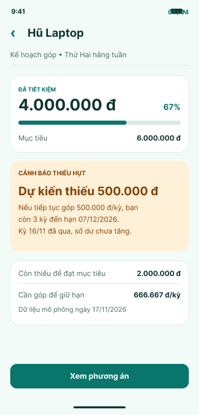
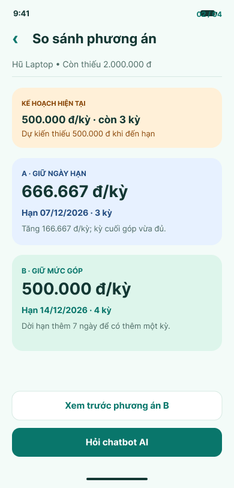
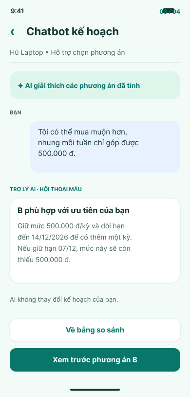
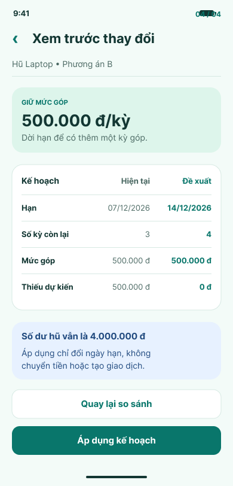
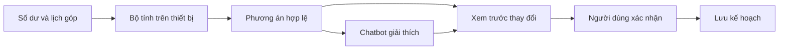

# Hũ tiết kiệm thông minh

**Đồ án phân tích và thiết kế ứng dụng Android để quản lý mục tiêu tiết kiệm bằng ví mô phỏng.**

Khi bỏ lỡ một kỳ góp, người dùng cần biết còn thiếu bao nhiêu, phải góp thêm bao nhiêu để kịp hạn, hoặc có thể dời hạn đến ngày nào. Hũ tiết kiệm thông minh dự báo khoản thiếu, so sánh các phương án và cho xem tác động trước khi người dùng áp dụng.

## Giao diện prototype

| Cảnh báo thiếu hụt | So sánh phương án |
| --- | --- |
|  |  |
| Hiển thị tiến độ, số kỳ còn lại và khoản thiếu dự kiến. | Đặt mức góp và ngày hạn của hai phương án cạnh nhau. |

| Chatbot hỗ trợ chọn phương án | Xem trước thay đổi |
| --- | --- |
|  |  |
| Giải thích phương án nào phù hợp với ưu tiên người dùng. | Đối chiếu hạn, số kỳ và khoản thiếu trước khi xác nhận. |

*Bốn màn xuất từ Figma. Chatbot trong prototype sử dụng hội thoại mẫu.*

## Kịch bản hũ Laptop

Hũ đã góp **4.000.000 đ** trên mục tiêu **6.000.000 đ** và dự kiến góp **500.000 đ** mỗi thứ Hai. Ngày 16/11/2026, lịch còn bốn kỳ đến hết 07/12/2026. Sang ngày 17/11, số dư vẫn như cũ và lịch còn ba kỳ. Với mức góp hiện tại, khoản thiếu dự kiến vào ngày hạn là **500.000 đ**.

| Phương án | Mức góp mỗi kỳ | Ngày hạn | Tác động |
| --- | ---: | --- | --- |
| A. Giữ ngày hạn | 666.667 đ | 07/12/2026 | Kỳ cuối góp 666.666 đ để vừa đủ mục tiêu. |
| B. Giữ mức góp | 500.000 đ | 14/12/2026 | Dời hạn 7 ngày để có thêm một kỳ góp. |

Nếu người dùng chỉ có thể góp 500.000 đ mỗi kỳ và phải giữ hạn 07/12, bộ tính trả về khoản thiếu **500.000 đ** và báo rằng hai điều kiện chưa thể đáp ứng đồng thời. Khi người dùng xác nhận một phương án, hệ thống chỉ cập nhật kế hoạch. Số dư và lịch sử giao dịch giữ nguyên.

## Nghiệp vụ của đồ án

| Nhóm chức năng | Hành vi theo thiết kế |
| --- | --- |
| Ví mô phỏng | Nạp, chi và kiểm tra số dư khả dụng trước khi ghi giao dịch. |
| Hũ tiết kiệm | Tạo hũ theo mục tiêu, góp từ ví, rút về ví, lưu trữ và khôi phục hũ. Chuyển giữa ví và hũ giữ nguyên tổng tiền mô phỏng. |
| Lịch sử và thống kê | Tra cứu theo ví, hũ và khoảng thời gian. Hủy giao dịch được ghi bằng bút toán đảo và giữ lại bản ghi gốc. |
| Kế hoạch và nhắc góp | Tính lại theo lịch góp, mục tiêu và số dư. Thông báo mở màn góp để người dùng xem và xác nhận. |

## Cách tính kế hoạch

1. Lấy mục tiêu trừ số dư để tính số tiền còn thiếu, tối thiểu là 0 đồng.
2. Đếm đúng các ngày góp trong lịch hằng ngày hoặc hằng tuần, tính đến hết ngày hạn. Nếu đã đủ mục tiêu, mức cần góp là 0 đồng. Nếu còn thiếu mà hết kỳ, gợi ý đổi lịch hoặc gia hạn.
3. Chia số tiền còn thiếu cho số kỳ và làm tròn lên đến một đồng. Với mức góp đã chọn, lấy số tiền còn thiếu trừ tổng dự kiến góp để tính khoản thiếu vào ngày hạn.
4. Khi người dùng xác nhận thay đổi, đọc lại số dư và kế hoạch. Nếu dữ liệu đã đổi từ lúc mở bản xem trước, tính lại và yêu cầu xem lại trước khi lưu.

## Vai trò của AI

Bộ tính trên thiết bị tạo các phương án và cung cấp số tiền, ngày hạn chính thức. Chatbot nhận ưu tiên như *“Tôi có thể mua muộn hơn, nhưng mỗi tuần chỉ góp được 500.000 đ”* để giải thích vì sao phương án B phù hợp. Ứng dụng kiểm tra mã phương án do AI trả về trước khi hiển thị lời giải thích.

Theo thiết kế, dịch vụ trung gian giữ khóa API và chỉ nhận ưu tiên cùng số liệu tóm tắt của hũ đang xem. Khi mất mạng hoặc dịch vụ lỗi, ứng dụng vẫn hiển thị bảng so sánh và dùng lời giải thích theo mẫu.

## Trạng thái

| Đã hoàn thành | Hướng triển khai |
| --- | --- |
| Báo cáo phân tích, đặc tả nghiệp vụ và ca kiểm thử dự kiến. | Dựng ứng dụng Flutter/Dart, lưu ví, hũ và sổ giao dịch bằng SQLite. |
| ERD cho ví, hũ, giao dịch, kế hoạch góp và nhắc nhở. | Kiểm thử bộ tính với dữ liệu Laptop và các trường hợp hết kỳ, đạt mục tiêu hoặc đổi số dư trong lúc xem trước. |
| Prototype Figma của kịch bản Laptop. | Kết nối dịch vụ AI và kiểm thử fallback khi dùng trên Android. |
